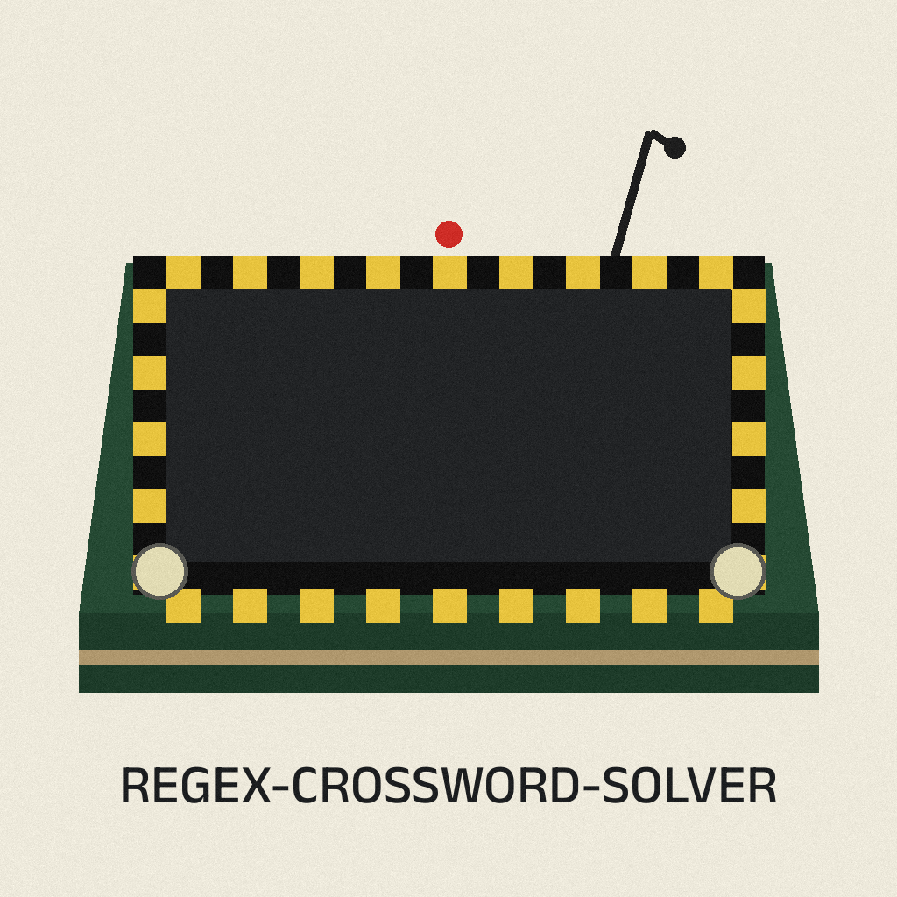

# Regex Crossword Solver

<p align="center"></p>


A regex crossword solver written in Python. It parses each row and column regex with a PLY grammar (see `grammar.md`), turns the puzzle into an SMT problem, and solves it with Z3. Backreferences are supported, so puzzles that use groups and references such as `\1` can be solved, including rectangular puzzles.

Codename: Red Robin.


## What is in this repo

- `crossword/`: The solver package. `regex_parser.py` is the PLY lexer and parser, `regex_solver.py` builds the Z3 expression for one regex at a fixed length, and `crossword.py` provides `solve_crossword(rows, cols, rows2=None, cols2=None)` and `solve_regex(regex, length)`.
- `custom-solver.py`: A ready to run example. It solves the 5 by 14 puzzle described in `specs.md` (a player puzzle from regexcrossword.com, also linked to a BBC Radio 4 puzzle page in the file header), then solves the Beginner Level 1 Beatles puzzle as a bonus.
- `ultimate-regex-solver.sh`: An interactive Bash menu. Option 2 runs the bundled `custom-solver.py` with your normal account, no raised privileges anywhere in the menu. Options 1, 3, and 4 download other people's external projects (see Credits) at one pinned commit each, show the file list, and stop: they do not run the downloaded code, and they do not delete a download folder that is already there. Option 1 in particular no longer runs its download with Python 2, because that external MIT Mystery Hunt project is Python 2 era code that should be read before anyone runs it. The pinned commits are recorded in the script itself. The menu is not needed to use the bundled solver. The script changes into its own folder first, so `custom-solver.py` is found wherever it is launched from.
- `crossword/tests/`: The unittest suite for the parser, the single regex solver, and full crosswords.
- `grammar.md` and `specs.md`: The regex grammar the parser implements, and the row and column regexes for the puzzle in `custom-solver.py`.

## Requirements

- Python 3 (verified on Python 3.12)
- `ply` and `z3-solver`: `pip install ply z3-solver`

The test suite runs on the standard library `unittest` runner. It does not need `nose`: the three test modules define a local `nottest` marker for their helper methods.

## Run the example solver

```bash
git clone https://github.com/Epsilon0xCell/Regex-Crossword-Solver.git
cd Regex-Crossword-Solver
pip install ply z3-solver
python3 custom-solver.py
```

Verified output: the 5 by 14 grid is solved and printed, followed by the Beatles bonus grid:

```
H  E
L  P
```

## Run the tests

```bash
python3 -m unittest discover -s crossword -t .
```

Verified on Python 3.12 with ply 3.11 and z3-solver 5.3.3: 60 tests pass, including under different `PYTHONHASHSEED` values. The suite is noisy by design: the solver tests print the regexes and the Z3 expressions they build. PLY also writes `parser.out` and `parsetab.py` next to the package when it runs; `make clean` removes those byproducts.

## Use it on your own puzzle

Edit the `rows` and `cols` lists in `custom-solver.py`, or call the package directly:

```python
from crossword import solve_crossword

answer = solve_crossword(["HE|LL|O+", "[PLEASE]+"], ["[^SPEAK]+", "EP|IP|EF"])
for line in answer:
    print("  ".join(line))
```

`solve_crossword` returns a list of rows of single characters, or `None` when Z3 finds no solution. The optional `rows2` and `cols2` arguments add a second set of regexes that the same grid must also satisfy.

## Notes on the parser

- Repetition counts may start at zero: `a{0}`, `a{0,0}`, `a{0,}`, and `a{0,2}` all parse and solve, and `a{0,2}` matches lengths 0, 1, and 2. This is covered by the `test_brace_zero` test.
- Character sets are parsed in sorted order, so parse trees do not depend on hash randomization.

## Credits

The bundled solver is based on the regex crossword solver by blukat29. The shell menu also links these external projects, which are not part of this repo:

- https://github.com/dneiter/regex-crossword
- https://github.com/deepaksood619/RegexCrossword
- https://github.com/blukat29/regex-crossword-solver

> **Log margin note:** mistyped row counts solve the wrong shape, so check the clue counts before blaming the solver. PLY also leaves parser.out and parsetab.py behind until make clean runs.
